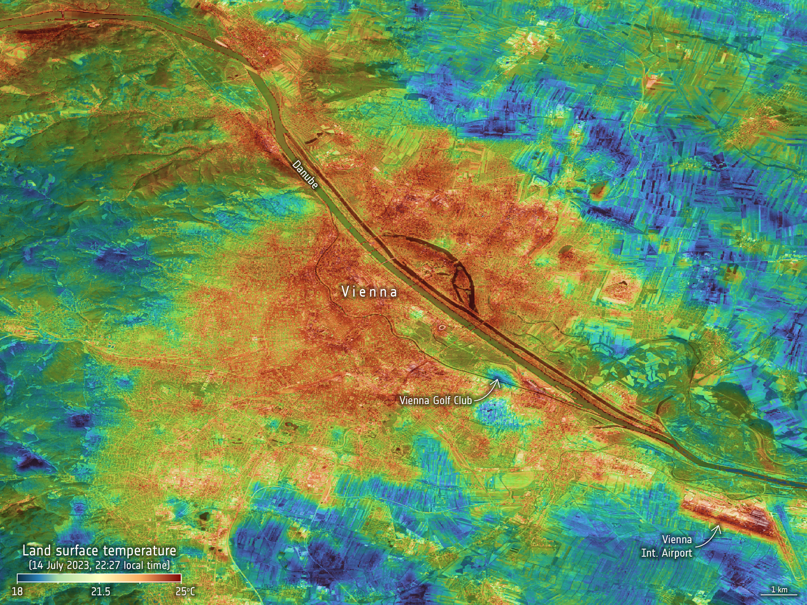

# Vienna Urban Heat Islands: Sentinel-3 Land Surface Temperature Analysis <!--{ as="img" mode="hero" src="https://raw.githubusercontent.com/EOX-A/git-clerk-test/37a43da27622c8f466050f45657dd4893d8b8216/assets/land-surface_temperature_in_vienna_on_14_july_2023-dd0de41c.jpg" }-->
#### Satellite observations reveal extreme microclimate contrasts and the cooling power of urban green infrastructure across Vienna. Reference analysis based on Sentinel-3 SLSTR thermal radiometry from 14 July 2023.

## Urban Thermal Dynamics & Satellite Monitoring
### Urban Heat Islands in Vienna

During intense summer heatwaves, urban environments undergo severe thermal stress. Dense construction materials—such as asphalt, dark roofing, and reinforced concrete—absorb incoming solar radiation during the day and re-radiate it slowly at night. In Vienna, this phenomenon creates pronounced **Urban Heat Islands (UHIs)**, driving surface temperatures in densely built inner-city districts significantly above surrounding rural and peri-urban landscapes. Elevated temperatures pose severe health risks to vulnerable populations and elevate municipal cooling demands [[JRC Science for Policy](https://publications.jrc.ec.europa.eu/repository/handle/JRC137891)].

*Figure 1: Thermal distribution across Vienna on 14 July 2023, measured via the Sea and Land Surface Temperature Radiometer (SLSTR) aboard Sentinel-3.* 

### Spaceborne Thermal Radiometry & Downscaling

Thermal infrared radiometry acquired by the [Copernicus Sentinel-3 Sea and Land Surface Temperature Radiometer (SLSTR)](https://dataspace.copernicus.eu/data-collections/copernicus-sentinel-missions/sentinel-3) measures Land Surface Temperature (LST) globally at a nominal 1 km spatial resolution. While 1 km pixels capture broad regional gradients, urban planners require parcel-level granularity. Advanced services such as the [Urban Heat Trend Monitor (UHTM)](https://gtif-austria.github.io/public-narratives/urban-heat-trend-monitor.md) combine Sentinel-3 thermal radiances with high-resolution optical indices (NDVI and NDBI from [Copernicus Sentinel-2](https://dataspace.copernicus.eu/data-collections/copernicus-sentinel-missions/sentinel-2)) using statistical downscaling (such as the TsHARP method) to generate actionable 70–100 m urban heat maps.

### Official Platform Narratives vs. Catalog Indicators

This analysis synthesizes official narrative insights and satellite data catalog layers:

- **Catalog Dataset / Indicator**: [Copernicus Sentinel-2 Level-2A Multispectral Imagery](https://dataspace.copernicus.eu/data-collections/copernicus-sentinel-missions/sentinel-2) and Sentinel-3 SLSTR Land Surface Temperature data provide continuous surface reflectance, vegetation density metrics, and radiometric temperature measurements over Vienna.
- **Official Dashboard Narratives**:
  - [Land surface temperatures projections, considering climate and land use changes](https://gtif-austria.github.io/public-narratives/heatgrid.md) (GTIF Austria / GeoVille): Models future 70 m LST projections under SSP3-7.0 climate and land-use scenarios across Austrian metropolitan areas.
  - [Urban Heat Trend Monitor](https://gtif-austria.github.io/public-narratives/urban-heat-trend-monitor.md) (GTIF Austria / OHB Digital Connect): Delivers super-resolution downscaling, SLIC thermal segmentation, and multi-year trend detection across Vienna's municipal districts.

## Vienna Urban Heat & Cooling Corridors Tour <!--{ as="eox-map" mode="tour" position="left" }-->

### <!--{ zoom=14 center=[16.368,48.206] layers='[{"type":"Tile","properties":{"id":"s2cloudless","title":"Sentinel-2 Cloudless"},"source":{"type":"WMTSCapabilities","url":"https://tiles.maps.eox.at/wmts/1.0.0/WMTSCapabilities.xml","layer":"s2cloudless-2025_3857","attributions":"<a href=\"https://s2maps.eu\" target=\"_blank\">\u00a9 Sentinel-2 cloudless by EOX IT Services GmbH</a> (Contains Copernicus Sentinel data)","crossOrigin":"anonymous"}},{"type":"Tile","properties":{"id":"sentinel-2-rgb","title":"Sentinel-2 True Color (RGB)","layerControlExpand":true,"layerControlToolsExpand":true},"source":{"type":"XYZ","url":"https://api.explorer.eopf.copernicus.eu/raster/collections/sentinel-2-l2a/items/S2B_MSIL2A_20260830T101019_N0512_R022_T33TTG_20260830T140344/tiles/WebMercatorQuad/{z}/{x}/{y}.png?variables=/measurements/reflectance:b04&variables=/measurements/reflectance:b03&variables=/measurements/reflectance:b02&rescale=0,1&color_formula=gamma rgb 1.3, sigmoidal rgb 6 0.1, saturation 1.2","crossOrigin":"anonymous","attributions":"<a href=\"https://browser.dataspace.copernicus.eu/\" target=\"_blank\">\u00a9 Copernicus Sentinel data</a>"}}]' animationOptions='{"duration":500}' }-->
#### 1. Densely Built Core: Innere Stadt & Neubau
High soil sealing and compact building canyons in central Vienna trap thermal radiation, producing surface temperatures exceeding 40°C on hot summer days ([UHTM GTIF Austria](https://gtif-austria.github.io/public-narratives/urban-heat-trend-monitor.md)).

### <!--{ zoom=13 center=[16.398,48.165] layers='[{"type":"Tile","properties":{"id":"s2cloudless","title":"Sentinel-2 Cloudless"},"source":{"type":"WMTSCapabilities","url":"https://tiles.maps.eox.at/wmts/1.0.0/WMTSCapabilities.xml","layer":"s2cloudless-2025_3857","attributions":"<a href=\"https://s2maps.eu\" target=\"_blank\">\u00a9 Sentinel-2 cloudless by EOX IT Services GmbH</a> (Contains Copernicus Sentinel data)","crossOrigin":"anonymous"}},{"type":"Tile","properties":{"id":"sentinel-2-rgb","title":"Sentinel-2 True Color (RGB)","layerControlExpand":true,"layerControlToolsExpand":true},"source":{"type":"XYZ","url":"https://api.explorer.eopf.copernicus.eu/raster/collections/sentinel-2-l2a/items/S2B_MSIL2A_20260830T101019_N0512_R022_T33TTG_20260830T140344/tiles/WebMercatorQuad/{z}/{x}/{y}.png?variables=/measurements/reflectance:b04&variables=/measurements/reflectance:b03&variables=/measurements/reflectance:b02&rescale=0,1&color_formula=gamma rgb 1.3, sigmoidal rgb 6 0.1, saturation 1.2","crossOrigin":"anonymous","attributions":"<a href=\"https://browser.dataspace.copernicus.eu/\" target=\"_blank\">\u00a9 Copernicus Sentinel data</a>"}}]' animationOptions='{"duration":500}' }-->
#### 2. High-Sealing Zones: Favoriten & Simmering
Large commercial flat roofs, rail terminals, and extensive asphalt yards in southern Vienna create intense thermal anomalies with minimal evaporative cooling ([GeoVille Heatgrid](https://gtif-austria.github.io/public-narratives/heatgrid.md)).

### <!--{ zoom=14 center=[16.425,48.201] layers='[{"type":"Tile","properties":{"id":"s2cloudless","title":"Sentinel-2 Cloudless"},"source":{"type":"WMTSCapabilities","url":"https://tiles.maps.eox.at/wmts/1.0.0/WMTSCapabilities.xml","layer":"s2cloudless-2025_3857","attributions":"<a href=\"https://s2maps.eu\" target=\"_blank\">\u00a9 Sentinel-2 cloudless by EOX IT Services GmbH</a> (Contains Copernicus Sentinel data)","crossOrigin":"anonymous"}},{"type":"Tile","properties":{"id":"sentinel-2-rgb","title":"Sentinel-2 True Color (RGB)","layerControlExpand":true,"layerControlToolsExpand":true},"source":{"type":"XYZ","url":"https://api.explorer.eopf.copernicus.eu/raster/collections/sentinel-2-l2a/items/S2B_MSIL2A_20260830T101019_N0512_R022_T33TTG_20260830T140344/tiles/WebMercatorQuad/{z}/{x}/{y}.png?variables=/measurements/reflectance:b04&variables=/measurements/reflectance:b03&variables=/measurements/reflectance:b02&rescale=0,1&color_formula=gamma rgb 1.3, sigmoidal rgb 6 0.1, saturation 1.2","crossOrigin":"anonymous","attributions":"<a href=\"https://browser.dataspace.copernicus.eu/\" target=\"_blank\">\u00a9 Copernicus Sentinel data</a>"}}]' animationOptions='{"duration":500}' }-->
#### 3. The Green Sponge: Wiener Prater
The dense canopy of the 6 km² Prater alluvial woodland reduces local surface temperatures by 6°C to 10°C compared to adjacent streets through active evapotranspiration and shade ([Copernicus Sentinel-3](https://dataspace.copernicus.eu/)).

### <!--{ zoom=13 center=[16.417,48.232] layers='[{"type":"Tile","properties":{"id":"s2cloudless","title":"Sentinel-2 Cloudless"},"source":{"type":"WMTSCapabilities","url":"https://tiles.maps.eox.at/wmts/1.0.0/WMTSCapabilities.xml","layer":"s2cloudless-2025_3857","attributions":"<a href=\"https://s2maps.eu\" target=\"_blank\">\u00a9 Sentinel-2 cloudless by EOX IT Services GmbH</a> (Contains Copernicus Sentinel data)","crossOrigin":"anonymous"}},{"type":"Tile","properties":{"id":"sentinel-2-rgb","title":"Sentinel-2 True Color (RGB)","layerControlExpand":true,"layerControlToolsExpand":true},"source":{"type":"XYZ","url":"https://api.explorer.eopf.copernicus.eu/raster/collections/sentinel-2-l2a/items/S2B_MSIL2A_20260830T101019_N0512_R022_T33TTG_20260830T140344/tiles/WebMercatorQuad/{z}/{x}/{y}.png?variables=/measurements/reflectance:b04&variables=/measurements/reflectance:b03&variables=/measurements/reflectance:b02&rescale=0,1&color_formula=gamma rgb 1.3, sigmoidal rgb 6 0.1, saturation 1.2","crossOrigin":"anonymous","attributions":"<a href=\"https://browser.dataspace.copernicus.eu/\" target=\"_blank\">\u00a9 Copernicus Sentinel data</a>"}}]' animationOptions='{"duration":500}' }-->
#### 4. Blue Infrastructure: Donauinsel & New Danube
The 21-kilometer Danube Island and adjoining water corridors serve as primary ventilation paths, maintaining surface temperatures several degrees below the surrounding urban matrix ([UHTM GTIF Austria](https://gtif-austria.github.io/public-narratives/urban-heat-trend-monitor.md)).

### <!--{ zoom=12 center=[16.275,48.23] layers='[{"type":"Tile","properties":{"id":"s2cloudless","title":"Sentinel-2 Cloudless"},"source":{"type":"WMTSCapabilities","url":"https://tiles.maps.eox.at/wmts/1.0.0/WMTSCapabilities.xml","layer":"s2cloudless-2025_3857","attributions":"<a href=\"https://s2maps.eu\" target=\"_blank\">\u00a9 Sentinel-2 cloudless by EOX IT Services GmbH</a> (Contains Copernicus Sentinel data)","crossOrigin":"anonymous"}},{"type":"Tile","properties":{"id":"sentinel-2-rgb","title":"Sentinel-2 True Color (RGB)","layerControlExpand":true,"layerControlToolsExpand":true},"source":{"type":"XYZ","url":"https://api.explorer.eopf.copernicus.eu/raster/collections/sentinel-2-l2a/items/S2B_MSIL2A_20260830T101019_N0512_R022_T33TTG_20260830T140344/tiles/WebMercatorQuad/{z}/{x}/{y}.png?variables=/measurements/reflectance:b04&variables=/measurements/reflectance:b03&variables=/measurements/reflectance:b02&rescale=0,1&color_formula=gamma rgb 1.3, sigmoidal rgb 6 0.1, saturation 1.2","crossOrigin":"anonymous","attributions":"<a href=\"https://browser.dataspace.copernicus.eu/\" target=\"_blank\">\u00a9 Copernicus Sentinel data</a>"}}]' animationOptions='{"duration":500}' }-->
#### 5. Regional Climate Regulator: Wienerwald
The elevated, forested slopes of the Vienna Woods generate cool air drainage at night, funneling refreshing breezes eastward into city valleys and significantly buffering heat stress ([GeoVille Heatgrid](https://gtif-austria.github.io/public-narratives/heatgrid.md)).

## Mitigation Strategies & Data Sources
### Strategic Urban Greening & Climate Adaptation

Thermal satellite observations confirm that urban vegetation and water bodies are essential municipal cooling infrastructure. In Vienna, preserving ventilation corridors from the Vienna Woods, expanding linear pocket parks in densely populated districts like Favoriten and Ottakring, and integrating green roofs significantly lower local surface temperatures. By decoupling urban densification from thermal vulnerability, European cities can build proactive climate resilience [[Destination Earth Climate DT](https://platform.destine.eu/)].

### Data Sources & References

- **Copernicus Sentinel-3 SLSTR & Sentinel-2 MSI**: Surface temperature radiometry and multispectral surface reflectance from the [Copernicus Data Space Ecosystem](https://dataspace.copernicus.eu/).
- **GTIF Austria Narratives**:
  - [Land surface temperatures projections, considering climate and land use changes](https://gtif-austria.github.io/public-narratives/heatgrid.md) by GeoVille.
  - [Urban Heat Trend Monitor](https://gtif-austria.github.io/public-narratives/urban-heat-trend-monitor.md) by OHB Digital Connect.
- **Scientific Literature**: Joint Research Centre (JRC) Science for Policy Report on urban heat extremes and spatial inequality [[JRC Repository](https://publications.jrc.ec.europa.eu/repository/handle/JRC137891)].
- **Basemap Services**: [Sentinel-2 Cloudless](https://s2maps.eu) by EOX IT Services GmbH.

*This story is an AI-generated draft. Verify scientific data and satellite visualizations independently.*